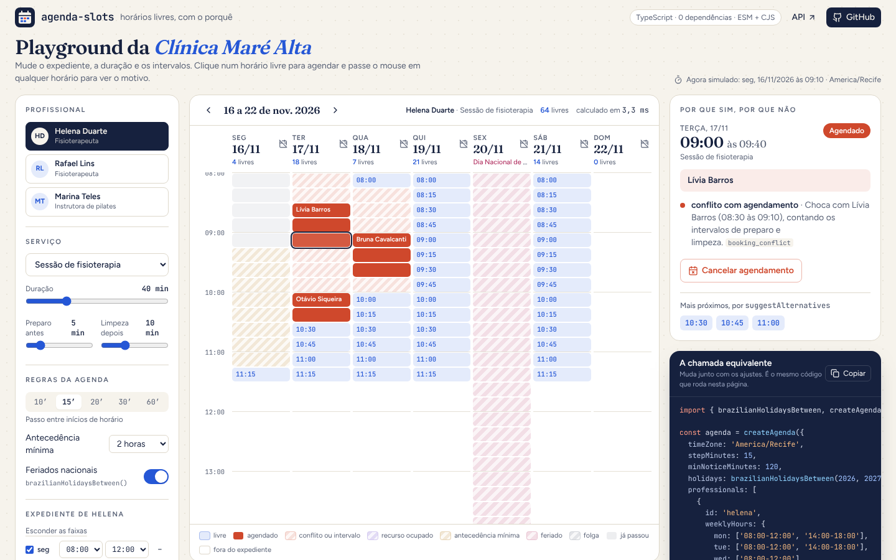
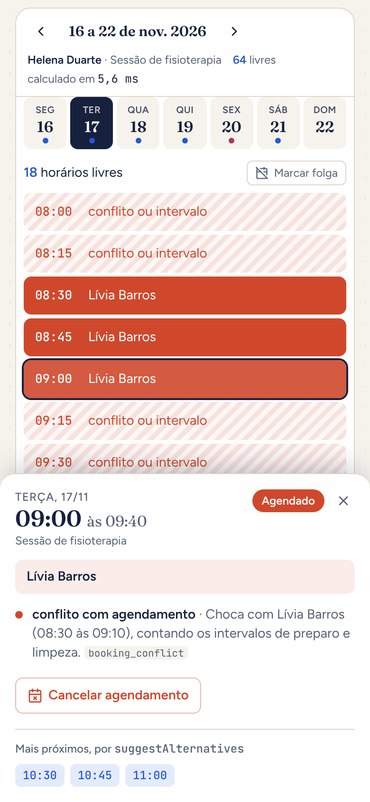

<div align="center">

# agenda-slots

**Biblioteca TypeScript sem dependências que calcula os horários livres de clínicas, salões e estúdios, e explica por que cada horário não está livre.**

Expediente com várias faixas por dia, folgas, feriados nacionais calculados por ano, agendamentos, intervalos de preparo e limpeza, salas e aparelhos compartilhados, turmas com vagas, antecedência mínima e fuso horário com horário de verão. Só `Intl`, sem moment nem luxon.

[](https://github.com/PRESSXF/agenda-slots/actions/workflows/ci.yml)


[**Abrir o playground**](https://agenda-slots.vercel.app) · [Exemplo rápido](#exemplo-r%C3%A1pido) · [API](#api) · [Receitas](#receitas) · [Como funciona](#como-funciona)


</div>

## O problema

Toda agenda online precisa responder "quais horários eu posso oferecer?". Parece um laço de 15 em 15 minutos, mas as regras se acumulam: a fisioterapeuta trabalha das 8 às 12 e das 14 às 18, menos na quarta à tarde; a sessão dura 40 minutos e precisa de 10 para limpar a sala; o aparelho de laser é um só para duas profissionais; o pilates aceita 4 alunos por horário; ninguém marca com menos de 2 horas de antecedência; dia 20 de novembro agora é feriado nacional; e o fuso de quem atende pode ter horário de verão.

Quando a conta erra, aparecem dois agendamentos no mesmo horário ou um horário bom some sem explicação. E quando o cliente pergunta "por que não posso às 10h?", o sistema não sabe responder.

## A solução

Uma função pura que recebe a configuração da agenda e devolve os horários livres por dia e por profissional. No modo explicação, cada horário da grade vem com a lista de motivos contra ele, em português e com código estável para a interface tratar.

| Regra | Como a biblioteca trata |
|---|---|
| Expediente com intervalo de almoço | Várias faixas por dia (`'08:00-12:00'`, `'14:00-18:00'`), fundidas se o cadastro tiver sobreposição |
| Folga e horário especial | Exceção por data substitui o expediente da semana; `hours: []` é folga |
| Feriados | `brazilianHolidays(ano)` calcula os nacionais, inclusive Carnaval, Sexta-feira Santa e Corpus Christi pela Páscoa; feriados locais entram como data |
| Agendamentos e intervalos | Preparo e limpeza do serviço novo e dos agendamentos existentes entram na conta |
| Sala e aparelho | Recursos com capacidade; ficam ocupados por agendamentos de qualquer profissional |
| Turma | `capacity` no serviço; o horário continua livre até lotar e devolve as vagas restantes |
| Antecedência e limite | `minNoticeMinutes` em horas reais e `maxDaysAhead` contado no fuso da agenda |
| Fuso horário | Nome IANA, padrão `America/Recife`; horário de verão resolvido com `Intl` |

## Instalação

O pacote está pronto para o npm (ESM, CommonJS e tipos), mas ainda não foi publicado. Para usar agora, gere o arquivo do pacote e instale a partir dele:

```bash
git clone https://github.com/PRESSXF/agenda-slots.git
cd agenda-slots && npm install && npm run build:lib && npm pack
# no seu projeto
npm install ../agenda-slots/agenda-slots-1.0.0.tgz
```

Funciona em Node 18 ou mais novo e em qualquer navegador atual. O pacote tem só `dist/`, `README.md` e `LICENSE` (menos de 40 kB compactado, com os tipos e este README).

## Exemplo rápido

```ts
import { brazilianHolidays, createAgenda } from 'agenda-slots'

const agenda = createAgenda({
  timeZone: 'America/Recife',
  stepMinutes: 15,
  minNoticeMinutes: 120,
  holidays: brazilianHolidays(2026),
  professionals: [
    {
      id: 'helena',
      weeklyHours: {
        mon: ['08:00-12:00', '14:00-18:00'],
        wed: ['08:00-12:00'],
        fri: ['08:00-12:00', '14:00-18:00'],
      },
    },
  ],
  services: [{ id: 'fisio', durationMinutes: 40, bufferAfterMinutes: 10 }],
  bookings: [{ id: 'b1', professionalId: 'helena', serviceId: 'fisio', start: '2026-11-16T14:00' }],
})

const [segunda] = agenda.slots({ serviceId: 'fisio', from: '2026-11-16', now: '2026-11-16T09:10' })

segunda.slots.map((s) => s.time)
// ['11:15', '15:00', '15:15', ..., '17:15']   (antes das 11:15: antecedência; 14:00 a 14:50: agendamento e limpeza)
segunda.slots[0].start
// '2026-11-16T11:15:00-03:00'
```

Data e hora sem deslocamento (`'2026-11-16T14:00'`) são lidas no fuso da agenda, nunca no fuso da máquina. Também valem ISO com deslocamento, `Date` e milissegundos.

### Por que não?

```ts
const [dia] = agenda.slots({ serviceId: 'fisio', from: '2026-11-16', now: '2026-11-16T09:10', explain: true })

dia.explained.find((e) => e.time === '14:30')
// {
//   time: '14:30', available: false,
//   reasons: [{
//     code: 'booking_conflict',
//     label: 'conflito com agendamento',
//     detail: 'Choca com fisio (14:00 às 14:40), contando os intervalos de preparo e limpeza.',
//     bookingIds: ['b1'],
//   }],
// }
```

## API

| Função | O que faz | Devolve |
|---|---|---|
| `createAgenda(config)` | Valida a configuração e monta os índices uma vez; use para várias consultas | `Agenda` com `slots`, `nextAvailable`, `suggest`, `check` |
| `getAvailableSlots(config, query)` | Horários livres por dia e profissional | `DayAvailability[]` |
| `findNextAvailable(config, query)` | Primeiro horário livre a partir de agora ou de `after` | `Slot \| null` |
| `suggestAlternatives(config, query)` | Horários livres mais próximos de um horário pedido, antes ou depois | `Slot[]` |
| `checkBooking(config, query)` | Confere um agendamento antes de gravar, com todos os motivos | `{ ok, reasons, slot }` |
| `flattenSlots(days)` | Junta os slots de todos os dias em ordem de início | `Slot[]` |
| `brazilianHolidays(ano, { optional })` | Feriados nacionais do ano; `optional: false` tira Carnaval e Corpus Christi | `Holiday[]` |
| `brazilianHolidaysBetween(de, até)` | Feriados de vários anos | `Holiday[]` |
| `easterSunday(ano)` | Domingo de Páscoa (Meeus/Jones/Butcher) | `'AAAA-MM-DD'` |
| `mergeIntervals(lista)` | Ordena e funde intervalos sobrepostos ou encostados | `Interval[]` |
| `subtractIntervals(base, tirar)` | Remove uma lista de intervalos de outra | `Interval[]` |
| `intersectIntervals(a, b)` | Partes comuns | `Interval[]` |
| `overlaps`, `contains`, `expand`, `totalDuration`, `maxConcurrency` | Operações básicas sobre `[início, fim)` | |
| `IntervalIndex` | Índice estático para "o que se sobrepõe a [a, b)?" em O(log n + k) | classe |
| `zonedTimeToEpoch(data, hora, fuso)` | Hora de parede para instante, com regra de horário de verão | `number` (ms) |
| `getZonedParts(ms, fuso)`, `formatInstant(ms, fuso)`, `getTimeZoneOffset(ms, fuso)`, `todayIn(fuso)`, `toEpoch(valor, fuso)` | Utilitários de fuso só com `Intl` | |
| `REASON_LABELS` | Rótulos em português de cada código de motivo | `Record<ReasonCode, string>` |
| `AgendaError` | Erro de configuração com `code` (`INVALID_TIME`, `UNKNOWN_SERVICE`...) | classe |

### Configuração (`AgendaConfig`)

| Campo | Tipo | Padrão | Observação |
|---|---|---|---|
| `timeZone` | `string` | `'America/Recife'` | Nome IANA |
| `professionals` | `Professional[]` | | `{ id, weeklyHours, exceptions?, serviceIds? }` |
| `services` | `Service[]` | | `{ id, durationMinutes, bufferBeforeMinutes?, bufferAfterMinutes?, resourceIds?, capacity? }` |
| `resources` | `Resource[]` | `[]` | `{ id, capacity?, blocked? }`, por exemplo uma sala em manutenção |
| `bookings` | `Booking[]` | `[]` | `{ id, professionalId, start, end?, serviceId?, resourceIds?, seats? }`; sem `end`, usa a duração do serviço |
| `holidays` | `(Holiday \| 'AAAA-MM-DD')[]` | `[]` | Fecha para todos, salvo exceção do profissional |
| `stepMinutes` | `number` | `15` | Distância entre inícios |
| `minNoticeMinutes` | `number` | `0` | Antecedência mínima |
| `maxDaysAhead` | `number` | `60` | Até quantos dias à frente a agenda abre |
| `alignment` | `'hours' \| 'clock'` | `'hours'` | `hours`: a grade começa no início de cada faixa; `clock`: múltiplos do passo desde a meia-noite |

### Consulta (`SlotQuery`)

| Campo | Padrão | Observação |
|---|---|---|
| `serviceId` | | Obrigatório |
| `from` | hoje no fuso | Primeiro dia |
| `to` ou `days` | `days: 1` | `to` é inclusivo |
| `professionalIds` | todos que atendem o serviço | Pedir um profissional que não atende devolve o motivo `service_not_offered` |
| `now` | `Date.now()` | Fixe nos testes |
| `explain` | `false` | Inclui `explained` em cada dia |
| `explainWindow` | expediente semanal | `{ start: '07:00', end: '20:00' }` |

### Motivos

| Código | Rótulo | Quando |
|---|---|---|
| `outside_hours` | fora do expediente | O atendimento não cabe inteiro numa faixa do dia |
| `booking_conflict` | conflito com agendamento | Choca com agendamento ou com os intervalos de preparo e limpeza |
| `resource_busy` | recurso ocupado | Sala ou aparelho em uso por outro profissional, ou bloqueado |
| `min_notice` | antecedência mínima | Começa antes de `agora + minNoticeMinutes` |
| `holiday` | feriado | Data na lista de feriados, sem exceção do profissional |
| `day_off` | folga | Exceção com `hours: []` |
| `past` | horário já passou | Antes de agora |
| `beyond_max_days` | além do limite de dias | Depois de `hoje + maxDaysAhead` |
| `full` | turma lotada | Todas as vagas ocupadas |
| `service_not_offered` | serviço não oferecido | O profissional não atende esse serviço |
| `off_step` | fora da grade de horários | Cabe, mas não cai no passo (só no modo explicação e em `checkBooking` com `requireStep`) |

Um horário pode ter vários motivos ao mesmo tempo, e todos vêm na lista.

## Receitas

**Folga, horário especial e feriado municipal**

```ts
professionals: [{
  id: 'helena',
  weeklyHours: { mon: ['08:00-12:00', '14:00-18:00'] },
  exceptions: [
    { date: '2026-11-18', hours: [], reason: 'congresso' },     // folga
    { date: '2026-11-20', hours: ['09:00-12:00'] },             // abre no feriado
  ],
}],
holidays: [...brazilianHolidays(2026), { date: '2026-06-24', name: 'São João' }],
```

**Sala compartilhada e turma**

```ts
services: [
  { id: 'laser', durationMinutes: 20, bufferAfterMinutes: 5, resourceIds: ['laser'] },
  { id: 'pilates', durationMinutes: 55, capacity: 4, resourceIds: ['estudio'] },
],
resources: [{ id: 'laser' }, { id: 'estudio' }],
// slots de pilates trazem `remaining`: vagas que ainda cabem naquele horário
```

**"Não tem às 14:30? Me mostre os mais próximos"** (com a agenda do exemplo rápido)

```ts
agenda.suggest({ serviceId: 'fisio', at: '2026-11-16T14:30', limit: 3, now: '2026-11-16T09:10' })
// [{ time: '15:00', ... }, { time: '15:15', ... }, { time: '15:30', ... }]
```

**Validar no back-end antes de gravar**

```ts
const { ok, reasons } = agenda.check({ serviceId: 'fisio', professionalId: 'helena', start: pedido.inicio, requireStep: true })
if (!ok) return res.status(409).json({ motivos: reasons.map((r) => r.detail) })
```

**Primeiro horário livre de qualquer profissional**

```ts
agenda.nextAvailable({ serviceId: 'fisio' }) // percorre os dias até achar, respeitando maxDaysAhead
```

## A interface

O [playground](https://agenda-slots.vercel.app) é a agenda de uma clínica fictícia de fisioterapia e pilates, com o "agora" fixo numa segunda-feira de manhã para todo mundo ver a mesma coisa. Dá para:

1. Trocar profissional e serviço, mudar duração, preparo, limpeza, passo e antecedência.
2. Editar o expediente de cada dia (duas faixas) e marcar folga numa data.
3. Ligar e desligar os feriados nacionais (20/11 cai nessa semana).
4. Clicar num horário livre para agendar e num agendamento para cancelar.
5. Passar o mouse, usar as setas ou tocar num horário para ver os motivos, com o código de cada um e as sugestões de `suggestAlternatives`.
6. Ver e copiar a chamada da biblioteca que corresponde aos ajustes atuais.

No celular, a semana vira uma lista por dia e a explicação abre numa folha na parte de baixo.

<table>
  <tr>
    <td width="68%"></td>
    <td></td>
  </tr>
</table>

## Como funciona

```
AgendaConfig ──► compile() ── valida, converte durações, indexa agendamentos
                    │            por profissional e por recurso (IntervalIndex)
                    ▼
para cada dia × profissional:
   planDay()          expediente da semana │ exceção │ feriado
                      ──► faixas em instantes UTC com zonedTimeToEpoch (Intl)
   candidateStarts()  inícios a cada stepMinutes que cabem na faixa
   evaluate(t)        ┌ passado / antecedência / limite de dias
                      ├ serviço oferecido? dentro do expediente?
                      ├ agenda do profissional  [t - preparo, fim + limpeza)
                      ├ vagas da turma
                      └ recursos com capacidade (varredura de eventos)
                      ──► Reason[]  (vazio = livre)
                    ▼
DayAvailability { slots, explained?, holiday?, closed }
```

Tudo é calculado em instantes (milissegundos UTC) com intervalos semiabertos `[início, fim)`. O fuso só aparece em duas fronteiras: quando o expediente "08:00" vira instante e quando o resultado volta a ser "08:00" com deslocamento. Por isso o horário de verão não precisa de caso especial no motor: num dia de 23 ou 25 horas, as faixas simplesmente têm a duração real.

Decisões, complexidade e limites em [`docs/ARQUITETURA.md`](docs/ARQUITETURA.md).

## Testes

115 testes em 8 arquivos, cobertura de 99,7% das linhas e 96,9% dos ramos (`@vitest/coverage-v8`, mínimo de 90% configurado).

| Arquivo | O que cobre |
|---|---|
| `interval.test.ts` | Fusão, subtração, interseção, simultaneidade e o `IntervalIndex` comparado com busca ingênua em 500 consultas |
| `time.test.ts` | Datas civis, virada de mês e ano, 29 de fevereiro, validação |
| `timezone.test.ts` | Deslocamentos, hora inexistente e hora repetida em São Paulo (2018/2019), Nova York (2025) e Lord Howe (troca de meia hora) |
| `holidays.test.ts` | Páscoa em anos conhecidos e extremos, feriados de 2025, 2026 e 2027, Consciência Negra só a partir de 2024 |
| `engine.test.ts` | Faixas, borda do dia, `24:00`, passo e alinhamento, conflitos, intervalos, recursos, turmas, antecedência, feriados, exceções, motivos e validação |
| `dst.test.ts` | Expedientes que atravessam a troca de horário: 3 horas reais num dia, 5 em outro, 23:00 que acontece duas vezes |
| `helpers.test.ts` | Próximo horário, sugestões, checagem com e sem grade, `createAgenda` |
| `property.test.ts` | 60 clínicas aleatórias com gerador determinístico: nenhum slot sobrepõe agendamento, todos passam no `checkBooking`, explicação concorda com a lista, mais restrição nunca cria horário |

```bash
npm run test:coverage
npm run check:package   # conteúdo do npm pack e importação em ESM e CommonJS
```

## Rodar localmente

Requer Node.js 20 ou mais novo para o desenvolvimento (a biblioteca roda em Node 18+).

```bash
git clone https://github.com/PRESSXF/agenda-slots.git
cd agenda-slots
npm install
npm run dev        # playground em http://localhost:5173
```

| Comando | O que faz |
|---|---|
| `npm run dev` | Playground em modo de desenvolvimento |
| `npm test` | Todos os testes |
| `npm run test:coverage` | Testes com relatório de cobertura |
| `npm run lint` | ESLint |
| `npm run build` | Checagem de tipos, build da biblioteca (tsup) e do site (Vite) |
| `npm run build:lib` | Só a biblioteca: `dist/` com ESM, CJS e `.d.ts` |
| `npm run check:package` | Confere o `npm pack --dry-run` e importa o pacote nos dois formatos |

## Estrutura

```
src/                 a biblioteca (nenhuma importação externa)
├── engine.ts        compilação da configuração, plano do dia, avaliação de horários
├── helpers.ts       próximo horário, sugestões, checagem
├── agenda.ts        createAgenda: compila uma vez, consulta várias
├── interval.ts      aritmética de intervalos e IntervalIndex
├── timezone.ts      fuso com Intl e cache de deslocamento por hora
├── holidays.ts      Páscoa e feriados nacionais
├── time.ts          datas e horas civis
├── reasons.ts       rótulos dos motivos
└── types.ts         tipos públicos
tests/               Vitest, incluindo testes de propriedade
site/                playground em Vite, React e Tailwind (importa src/ pelo nome do pacote)
scripts/             checagem do pacote
```

## Stack

TypeScript em modo estrito, tsup (ESM, CommonJS e tipos), Vitest com cobertura v8 e GitHub Actions. O playground usa React 18, Vite e Tailwind CSS, e é estático. A biblioteca não tem nenhuma dependência de execução.

## Próximos passos

- Faixas que atravessam a meia-noite (plantões noturnos) sem precisar dividir em duas datas.
- Expediente próprio para recursos (sala que só abre à tarde).
- Fuso por profissional, para equipes em estados diferentes.
- Publicação no npm com provenance.

## Licença

Todos os direitos reservados. O código está público para avaliação: você pode lê-lo e rodá-lo localmente para conhecer o projeto. Copiar, modificar ou usar em outro projeto exige autorização por escrito. Detalhes em [`LICENSE`](LICENSE).

---

A Clínica Maré Alta é fictícia. Profissionais, pacientes e agendamentos foram inventados para a demonstração.

Feito por [João Guilherme Gomes de Araújo](https://www.linkedin.com/in/joaoguilhermegr/) · [ClairiX](https://clairix.enterprises/cases)
